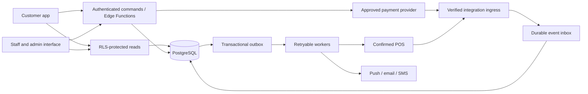

# Pogo’s Zimbabwe production implementation plan

Prepared: 30 October 2026. Updated with customer-confirmed operating scope. Status: implementation baseline with remaining decisions listed below.

Customer: the Pogo’s restaurant chain in Zimbabwe. Confirm the contracting legal entity, trading name, branch structure, and authorised business owner during discovery. This plan covers the existing Expo / React Native and Supabase application, including its GAAP integration work.

The outcome is a dependable ordering and loyalty service that restaurant staff can operate, finance can reconcile, customers can trust, and Pogo’s can own and maintain. Production readiness includes operational training, vendor agreements, recoverability, privacy, and release support as well as working software.

## 1. Scope, assumptions, and success

### Confirmed operating context and release scope

The customer has confirmed three active Zimbabwe branches: **Msasa, Kamfinsa, and Westgate**. The POS vendor is **GAAP**. Release 1 must support **loyalty and ordering with cash on collection/delivery**, using the existing cash-on-delivery operating model. **Digital payments follow in a later release.** Launch priority is **as soon as safely possible**; no fixed launch date, budget, team capacity, or pilot branch has been supplied.

Branch names, vendor, release sequence, and urgency are confirmed facts. Branch addresses, hours, delivery zones/fees, collection procedures, accepted currencies, GAAP versions/API access, and delivery staffing/cash handover controls still need operational verification. Do not infer these details from the branch names or demo data.

| Release | Included | Conditions |
| --- | --- | --- |
| Internal release | Verified data for Msasa, Kamfinsa and Westgate; secure customer/staff/admin access; transactional cash ordering and loyalty | Synthetic data and internal testers only; test existing GAAP till/receipt workflow |
| Release 1 pilot | Loyalty earning/redemption, ordering and meal customisations, cash collection/delivery, staff fulfilment, receipts, support, monitoring, deletion | Pilot at one of the three branches chosen by readiness; approved delivery zones/fees and cash procedures; secure GAAP integration or the audited manual till bridge below |
| Release 1 chain rollout | The same cash-first product at Msasa, Kamfinsa and Westgate; branch isolation, daily cash/points reconciliation and trained staff | Each branch passes its activation gate; digital-payment onboarding does not block this release |
| Release 2 | Verified digital payments, settlement/refunds, and GAAP automation not already activated in Release 1 | Provider-specific live tests; GAAP contract/capability tests; finance and operations activation gates |
| Later enhancements | Referral campaigns, point gifting, richer achievements, advanced marketing, AI support, third-party dispatch, customer web ordering | Prioritise after stable core operations and measured customer demand |

GAAP is the confirmed POS vendor; its installed capabilities must be established before automatic sync is promised. Keep GAAP discovery on the immediate work list. Digital payments are explicitly outside Release 1 and their implementation must not block cash checkout, cash refunds, reconciliation, or fiscal receipt handling. An optional capability can remain disabled; its status must be clear in the app and operations documentation.

Planning assumptions: two experienced full-time engineers, part-time QA, access to a Pogo’s operations lead and finance representative, part-time design/security support, and timely vendor access. The original 16–20 calendar week estimate describes the broader roadmap, including integrations, not a requirement to wait that long before Release 1. The accelerated cash-first critical path below takes precedence for Release 1; commit its date after the first sprint establishes staffing, platform health and branch readiness. A solo implementation needs a separate estimate. Vendor onboarding, legal review, hardware procurement, and store review can extend elapsed time.

### Earliest safe cash-first launch

Prioritise these work packages in order; run independent work alongside them when staffing permits:

1. Contain unsafe points/privileged endpoints; establish complete migrations, working builds, permission tests and CI.
2. Verify all three branch records, approved menu/modifiers, cash currencies, delivery zones/fees, staff assignments and existing GAAP receipt process.
3. Deliver server quotations, atomic orders, address/modifier snapshots, branch queues and authorised cash receipt/handover.
4. Deliver the loyalty ledger, earning after confirmed cash payment and completion, staff-confirmed rewards, reversals and cash reconciliation.
5. Complete identity recovery/deletion, monitoring, notification and reconnect handling, privacy/fiscal decisions, recovery rehearsal and staff training.
6. Pilot at the best-prepared branch, observe at least two representative trading weeks, then enable the other two branches individually after readiness checks.

Keep digital-provider selection/onboarding as a later-release workstream unless finance wants to start commercial discussions early. Defer new SMS login, broad campaign tooling, gifting, referral automation, AI support, advanced achievements, and a separate web dashboard. Use the existing supported authentication and staff interface where they meet release gates. Select initial distribution platforms from actual customer/staff device needs; an Android-first release is an option to decide, not a confirmed preference.

GAAP API availability must not be replaced with the current insecure mock integration. If automation would delay Release 1, operations and finance may approve an audited manual till bridge: staff record the app order reference in the GAAP sale, capture the corresponding GAAP receipt/fiscal reference against that order, confirm authorised cash collection/handover, and reconcile till totals to app orders and loyalty daily. Customer earn/redemption effects still run exclusively through trusted server commands with unique sale references. Define manual cash refunds and reward-discount entry in the till, staff permissions, exception review and workload limits. This bridge must be rehearsed and signed off before use; otherwise verified GAAP integration remains a launch dependency. Keep automatic in-store point-earning claims disabled until their integration gate passes.

Proposed success measures, to be approved before the pilot:

- Every accepted order reaches a terminal state or a visible exception queue with a named owner.
- Money, receipts, order status, and loyalty reconcile with no unexplained variance.
- At least 99.5% crash-free sessions during the pilot; target 99.9% for general release.
- Business-critical API availability target of 99.9% monthly after rollout; separately report upstream outages and customer impact.
- P95 first-party quote/order/status requests below two seconds under the agreed peak load, measured from backend ingress; mobile carrier and payment-provider latency measured separately.
- No unresolved critical or high security findings; no missing or duplicate financial/loyalty effects in retry and concurrency tests.
- Staff can operate a full service shift, including outages, refunds, stockouts, and support escalation.
- Growth measures: completed orders, repeat purchases, redemption rate, order abandonment, preparation time, cancellation rate, support contacts, and reward cost. Establish baseline before setting growth targets.

### Business decisions and dependencies

| ID | Decision / evidence needed | Accountable owner | Due / consequence |
| --- | --- | --- | --- |
| D01 | Legal entity, brand owner, branch ownership/franchises, contracting and data-controller roles | Pogo’s sponsor | Week 1; required for accounts, merchant onboarding, and privacy notices |
| D02 | Confirmed branches: Msasa, Kamfinsa, Westgate. Verify each branch’s contacts, coordinates, hours, holidays, menu, modifiers, photos, allergens, prices and availability; choose pilot by readiness | Operations + brand lead | Week 1–2; blocks real catalogue import |
| D03 | Cash collection/delivery is the confirmed release scope; verify existing delivery team/provider, zones, charges, minimum order, capacity, proof of handover, cash custody and failed-delivery rules | Operations | Week 1; blocks delivery activation |
| D04 | Accepted tender and settlement currencies per branch and method; USD/ZWG policy, FX source, rounding, taxes, refund rules | Finance | Week 1; blocks money model finalisation |
| D05 | Digital payments confirmed for Release 2; later select provider, merchant account owner, fees, settlement, refunds and credentials | Finance + technical lead | Release 2 discovery; does not block cash-first release |
| D06 | GAAP vendor confirmed. Verify version/capabilities per branch, contract, API spec, identifiers, sandbox, event signing, refunds, fiscal workflow and order injection; decide automation versus approved manual till bridge for Release 1 | Operations + GAAP contact | Start Week 1; blocks automated POS claims/redemption and determines till-bridge feasibility |
| D07 | Loyalty earn basis, excluded items, taxes/fees treatment, currency conversion, reward margins, expiry, refunds, transfer limits, opening balances | Finance + marketing | Week 2; blocks loyalty production rules |
| D08 | Email/password versus phone OTP; Zimbabwe SMS delivery/cost, account recovery, staff MFA, minimum age, language priorities | Product + operations | Week 1–2; blocks identity implementation |
| D09 | Android/iOS distribution priorities, existing app listings/package IDs, current users, staff hardware and connectivity | Sponsor + technical lead | Week 1; determines release and migration work |
| D10 | Existing database records, real versus demo balances, provider projects, current deployments, retention and migration authority | Technical lead + finance | Week 1; blocks cutover design |
| D11 | Data protection, hosting region/cross-border processing, contracts, retention, fiscal responsibilities | Pogo’s legal/privacy + finance | Begin Week 1; must resolve before real-customer pilot |
| D12 | Launch urgency confirmed: ASAP. Establish funded team capacity, budget ceiling, support coverage, peak demand and the earliest defensible Release 1 date after first-sprint findings | Sponsor | Week 1; determines committed delivery baseline |

Public research is supporting context, not the branch master record. A public site presents Pogo’s Great Pizza & Chicken at Kamfinsa; confirm its ownership and current accuracy with the customer. The repository contains burger demo content, fictional US branch seeds, mixed currencies, and South African phone prompts. Replace these with customer-approved data. [Pogo’s public site](https://pogosgpc.com/)

## 2. Current implementation baseline

Implementation has started. See [implementation progress](implementation-progress.md) for completed local work, validation evidence and deployment prerequisites. Findings below record the original assessment; they are not a claim that every issue remains unchanged.

The review found these production blockers:

| Finding | Main locations | Required response |
| --- | --- | --- |
| Customers can write balances and purchase records; QR scanning awards a fixed demo amount | `hooks/useRewards.ts`, `app/scan.tsx`, initial points/transaction policies | Trusted, auditable loyalty commands; validated receipt claims; remove client balance writes |
| Transfer RPC trusts caller-supplied sender; GAAP processing function lacks caller restriction | `20260916000000_share_points_rpc.sql`, `20261001000000_gaap_integration.sql` | Derive identity from auth, explicit function privileges, fixed search path, authorisation tests |
| GAAP webhook accepts missing signatures | `supabase/functions/gaap-webhook/index.ts`, `supabase/config.toml` | Reject unsigned requests, verify actual vendor contract, restrict processing RPC |
| Checkout trusts client prices and splits related writes | `app/(app)/cart.tsx` | Server quotation, atomic order creation, idempotency, payment/fulfilment policy |
| Delivery address and selected modifiers are not preserved in the order | `contexts/CartContext.tsx`, menu/cart screens | Immutable order snapshots and modifier-aware cart identity |
| Address cache is shared across accounts | `contexts/OrderContext.tsx` | User-scoped cache and complete logout/account-switch clearing |
| Schema creation is incomplete; staff changes are in an ad hoc script | `supabase/migrations`, `migrate-staff-role.js` | Full migration history or reviewed baseline and controlled upgrades |
| Type checking failed with 100 diagnostics in the preceding review | `lib/types.ts`, application hooks/screens | Regenerate types, fix errors, enforce checks in CI |
| Push, offline processing, Sentry, and documentation include placeholders or legacy behaviour | Notification/offline hooks, edge functions, root layout, README | Finish supported paths and remove misleading states |
| Preview OTA publishing has no quality gates | `.github/workflows/eas-update.yml` | Tested staging promotion, production approval, compatibility and rollback controls |

Repeat the baseline checks when implementation begins; 100 is a recorded assessment result, not a future invariant. Inventory the deployed system read-only before changing production. Do not run repository maintenance scripts against a customer database during discovery.

## 3. Target architecture and boundaries

Retain Expo / React Native and Supabase. Address correctness within this structure before considering a platform rewrite. Use a modular application with clear catalogue, ordering, payments, loyalty, identity, notifications, and operations boundaries.

Use direct RLS-protected reads for safe data access. Route price-sensitive, privileged, financial, and lifecycle mutations through narrow commands. Each database mutation commits its related records in one PostgreSQL transaction. External provider calls run outside database transactions with durable intent, idempotent processing, retries, and compensation.

- Derive customer identity from the validated session; never trust a submitted actor or sender ID.
- Enforce branch membership and permitted actions in the database/command layer, including column-level limits where needed. Hiding a route is only presentation.
- Use minimum privileges for service workers. Keep service keys, payment secrets, webhook secrets, and POS credentials server-side.
- Use explicit request schemas, response contracts, structured errors, correlation IDs, rate limits, bounded pagination, and redacted logs.
- Capture immutable histories for orders, payments, loyalty, refunds, and privileged changes.
- Use durable inbox/outbox tables with bounded retry, dead-letter status, deduplication keys, and operator tooling. A callback or push notification alone is not reliable state storage.
- Introduce server-controlled feature flags by environment and branch, including order intake, digital payments, POS sync, claims, redemption, gifting, and campaigns.

Supabase functions have broadly executable defaults; explicitly revoke unneeded grants, grant only intended roles, validate ownership, and fix `SECURITY DEFINER` search paths. Table RLS alone does not secure privileged functions. [Supabase function security](https://supabase.com/docs/guides/database/functions#secure-a-database-function)

### Access model

| Actor | Allowed reads | Allowed commands | Explicit limits |
| --- | --- | --- | --- |
| Visitor | Active branches, approved menus, public programme terms | Browse; begin account creation | No private data or points/financial mutation |
| Customer | Own profile, addresses, orders, loyalty ledger, notifications | Quote/place own order, request cancellation/refund, claim eligible receipt, reserve reward, manage account | No arbitrary prices, balance writes, state changes, or identity linking |
| Branch staff | Assigned-branch fulfilment data, minimum necessary customer contact | Accept/prepare/ready/handover, record authorised cash collection, availability changes | No other-branch access, role administration, price changes, or unrestricted refunds |
| Branch manager | Branch exceptions, reconciliation, audit | Approved branch overrides/refunds within limits; staff actions within delegated scope | Amount limits, reason codes, additional approval for sensitive operations |
| Chain administrator | Chain catalogue/configuration and operations | Approved global changes, staff invitation/assignment, audited support actions | MFA; secrets unavailable through ordinary list/select endpoints |
| Finance | Payments, settlements, refunds, loyalty liability, fiscal references | Reconcile; approve governed adjustments/refunds | Access to customer data limited by operational need |
| Integration worker | Its inbox/outbox and narrowly required records | Verify/apply permitted provider events | No end-user credential or public direct invocation of privileged processors |

Implement branch memberships as explicit assignments, allowing multiple authorised branches. Default-deny new roles/actions. Add staff invitation and revocation through an authenticated administrator service; remove mobile calls to auth-admin APIs and the signup fallback that can change the administrator’s session.

## 4. Data and domain design

### Required records

| Domain | Proposed entities / extensions | Required invariants |
| --- | --- | --- |
| Organisation | Branches, hours/closures, branch memberships, service zones, fulfilment settings | Stable IDs; Africa/Harare business time; active branch and service mode validated server-side |
| Catalogue | Categories, products/variants, modifier groups/choices, branch prices/availability, media | Minimum/maximum modifier choices; versioned prices; availability and branch ownership checked |
| Customer | Profile, verified contacts, addresses, consent history, account lifecycle | Normalised contacts; customer ownership; deletion/retention rules |
| Orders | Quotes, orders, item/modifier snapshots, fulfilment address/contact, status events, idempotency records | Immutable price/currency/address at purchase; valid transitions; unique customer-scoped submission key |
| Payments | Attempts, events, refunds, reconciliation exceptions, settlement references | Provider references unique; amount/currency match order; cumulative refunds cannot exceed captured funds |
| Loyalty | Accounts, append-only ledger, earn rules, reward definitions, reservations/redemptions, claims, transfer records | Integer points; no double effect per business event; reserved/available accounting; traceable reversals |
| POS/fiscal | Verified customer links, product/branch mappings, external sales/line allocations, fiscal references, integration events | Unique provider/merchant/branch/event identity; one earn per physical sale across channels |
| Operations | Audit events, inbox/outbox jobs, notification devices/delivery, support cases, feature flags | Durable work; audited access; bounded personal data and retention |

Names are proposed domain names, not permission to replace existing production tables destructively. Write a schema design and compatibility mapping before implementation. Keep generated database types aligned with applied migrations.

### Money, currencies, and taxation

- Replace currency display strings and floating-point totals with structured currency codes and integer minor-unit values. Use exact decimal arithmetic for FX and tax rules; define rounding boundaries with finance.
- Start with only Pogo’s approved branch/tender currencies. USD and ZWG are candidates to confirm, not assumptions about merchant support. Remove EUR/GBP/CAD and hard-coded exchange rates unless required and supported.
- Distinguish catalogue, presentment, paid, and settlement currency/amount. Snapshot the approved rate, source, effective time, quote expiry, rule version, discounts, fees, taxes, and rounding adjustments.
- Prefer branch price lists in supported currencies; where conversion is required, configure a finance-approved rate with expiry and audit history. Never use a developer-entered static rate for real settlement.
- Persist cash tendered/change due in the order currency; confirm cash receipt through an authorised staff action. Record over/underpayment exceptions and reconciliation responsibility.
- Agree VAT/tax inclusion, fiscal receipts, invoice numbering, discounts, credit notes, refunds, and retention with Pogo’s accountant and POS provider. Implement approved rules; do not hard-code inferred tax rates.

ZIMRA publishes FDMS guidance and an API route for fiscalisation. Decide whether the existing fiscal POS or a certified provider issues each fiscal document. The app must retain the fiscal reference/status and expose failures for resolution; an order confirmation is not evidence of fiscalisation. [ZIMRA FDMS guidance](https://www.zimra.co.zw/news/22-taxmans-corner/2307-compliance-with-the-zimra-fiscalisation-data-management-system-fdms)

### Orders and fulfilment

1. Customer selects branch and collection/delivery before checkout; browsing must not require location permission.
2. Server creates a short-lived quote from product IDs, quantities, modifier IDs, fulfilment mode, address/zone, and applicable rewards. Server resolves prices, stock, hours, limits, fees, taxes, and currency.
3. Customer confirms the exact quote; submission uses a persistent idempotency key scoped to the customer and operation. Store its request fingerprint; network retries return the same order/result, and reuse with different contents is rejected.
4. A database transaction creates the order, complete item/modifier/address/contact snapshots, history, and any required reward reservation. Expired quotes require reconfirmation.
5. Digital payment is initiated against the committed order through a durable payment intent. Cash orders follow approved acceptance and collection rules.
6. Branch staff accept or reject within a configured interval. Expired acceptance routes to cancellation/refund or a visible exception, according to the payment state.
7. Staff manage preparation and handover. Customers see authoritative state after reconnecting; realtime updates are an optimisation with polling fallback.
8. Loyalty earning occurs once only after the approved settlement and fulfilment conditions. Cancellations and refunds produce compensating records.

Keep payment, order, fulfilment, and fiscal states separate. Proposed order states: `submitted -> accepted -> preparing -> ready -> completed`; delivery adds `out_for_delivery` before completion. Explicitly model rejected, expired, cancelled, and exception outcomes and their permitted transitions. Refund status belongs to the payment domain, not an overloaded order status.

Validate every transition against actor, branch, prior state/version, and payment conditions. Use optimistic concurrency or row locks so two staff devices cannot complete conflicting transitions. Preserve actor/time/reason history. Configure closed/paused branches, holidays, stockouts, intake limits, preparation estimates, and cancellation cutoffs.

Delivery requires an approved zone, fee/minimum, customer contact, written address, map pin when available, landmarks, delivery instructions, assignment/handover responsibility, and completion evidence. Use kilometres and Africa/Harare time. Replace the current distance-based ETA formula with operationally approved ranges; do not imply live driver tracking before it exists.

### Loyalty and redemption

- Treat the ledger as the balance source of truth, with a transactionally maintained account projection and reconciliation job. Use event IDs and uniqueness constraints, not frontend state, for duplicate prevention.
- Version earn rules and define eligible net spend, currency basis, excluded lines, rounding, refund effects, expiry, and reward margin. Receiving/transferring points must not artificially increase spend-based tiers.
- Define what happens when refunded earning has already been spent: preserve the reversal in the ledger, record an approved points debt/adjustment and suspend further redemption if required. Finance must approve the policy; points recovery must not silently prevent a customer’s eligible monetary refund.
- Reserve points atomically when a reward is selected; available balance excludes reservations. Consume the reservation on approved fulfilment/redemption or release it on expiry/cancellation. Keep transitions idempotent.
- Issue a short-lived, single-use redemption token; authorised staff/POS confirm fulfilment. A customer’s success screen is not a redeemed meal. Prevent the same token being used at two branches.
- Receipt claims require authentic provider/branch receipts, verified eligible sales, expiry, ownership/claim limits, and unique receipt IDs. A fiscal QR can assist validation but does not itself prove customer ownership or unclaimed status. Unsupported claims enter a controlled support review or stay disabled.
- Connect first purchase, visit, and redemption achievements to canonical completed-sale events. Fix current mismatched transaction-type names and prevent bonus recursion or client updates overwriting trigger-awarded bonuses.
- Keep referrals/gifting disabled until rules, abuse limits, replay/concurrency tests, verified recipient handling, and cancellation/reversal policy are implemented. Referral rewards should require a qualifying completed purchase, not account creation alone.
- Existing balances require a finance-approved opening ledger entry with provenance. Segregate demo data; investigate discrepancies instead of trusting client-mutable historical balances.

### Digital payments

Use a provider adapter with initiate, status, callback verification, cancellation/expiry, and refund/reconciliation capabilities. Evaluate Paynow first as a local candidate, comparing actual Pogo’s merchant eligibility, currencies, payment methods, fees, settlement, refunds, support, and test facilities. Do not promise EcoCash, InnBucks, cards, or any other method until enabled and verified for the merchant account. Paynow documents integration credentials and server-side security requirements. [Paynow setup](https://developers.paynow.co.zw/docs/paynow/quickstart/), [API security](https://developers.paynow.co.zw/docs/paynow/paynow_api/)

- Initiate payments on the backend; never collect wallet PINs/card details or put integration keys in the mobile bundle. Use provider-approved hosted/mobile flows.
- Maintain payment states such as pending, paid, failed, expired, cancelled, partially refunded, refunded, and disputed where supported. Record every attempt and provider event.
- Validate callback authenticity using the provider’s exact specification; check merchant, order reference, amount, and currency. Reject invalid payloads; deduplicate valid repeats.
- Returning to the app does not mark an order paid. Confirm through verified callbacks or a trusted status query. Paynow documents callback hashes and polling. [Callback validation](https://developers.paynow.co.zw/docs/paynow/validating_hash/), [status polling](https://developers.paynow.co.zw/docs/paynow/polling_status/)
- Handle callbacks arriving before initiation response, duplicate/out-of-order status changes, delayed confirmation after expiry, abandoned app sessions, and upstream timeouts.
- Reconcile unresolved payment attempts with bounded polling/retry. Classify indeterminate timeouts as pending investigation; do not silently issue a second payment.
- For payment success after branch rejection/expiry, trigger the approved refund/exception workflow. Preserve evidence for chargebacks and settlement differences.
- Where the provider lacks a refund API, implement a controlled finance-assisted refund with reference, evidence, approval, and reconciliation status. Never mark refunded merely because a refund was requested.

### POS integration and sale identity

GAAP is the confirmed vendor for Pogo’s. Verify the installed version and capabilities at Msasa, Kamfinsa and Westgate and obtain the vendor contract before implementing automation. Public GAAP documentation mentions loyalty capabilities, but it does not confirm this repository’s assumed endpoint or event contract. [GAAP Unity documentation](https://docs.gaapunity.app/public/latest-features/Point-of-Sale)

- Record supported versions, credentials, merchant/branch/customer/product identifiers, signing/replay scheme, taxes, currencies, sale/void/refund events, retries, order injection, and certification requirements.
- Replace speculative webhook parsing with validated schemas, contract fixtures, authenticated ingress, timestamps/nonces where supported, payload limits, constant-time signature comparison, secret rotation, and strict unknown-branch rejection.
- Store verified events durably before acknowledging accepted delivery; process using service-only functions. Retry failed work and provide an audited replay tool.
- Use provider/merchant/branch/event uniqueness; distinguish immutable event IDs from sale IDs. Map later sale updates/refunds to the same sale without discarding them as duplicates.
- Prevent double earning when an app order also appears in the POS: link external sale to internal order and apply one canonical earn event. Allocate partial refunds to original lines and reverse the corresponding points.
- Verify customer links through a supported POS flow, verified contact challenge, or supervised branch process. Customers cannot self-assert a POS ID or set `verified`; normalise Zimbabwe numbers to E.164 and handle number changes/recycling.
- Maintain unmatched-sale and mapping queues with redacted diagnostics, owner, retry controls, and resolution history. Allow eventual matching within the approved claim period.
- Handle API outages and branch connectivity loss with durable retries and visible delay. If a vendor supports only polling/export, design a cursor/checkpoint adapter and revised customer promise.
- Complete end-to-end earning, redemption, refunds, and fiscal receipt tests at a real pilot till. Do not enable automatic earning based only on a locally simulated payload.

## 5. Implementation phases and acceptance gates

Task IDs below are implementation units suitable for separate issues/PRs. Estimate and split them at sprint planning; acceptance requires evidence, not checkbox completion. Phase week ranges remain the original full-roadmap estimate. For the ASAP cash-first release, follow the accelerated sequence above and the release classification in the CSV, then rebaseline the calendar after Sprint 1. Phase 5 is split so cash reconciliation and fiscal records have no dependency on digital-payment implementation or an unapproved POS API.

### Phase 0 — Discovery, ownership, and containment (Week 1)

| ID | Deliverable | Owner | Dependency | Acceptance evidence |
| --- | --- | --- | --- | --- |
| P0-01 | Record confirmed three-branch/GAAP/cash-first scope, resolve remaining decisions, choose pilot and identify support/release authority | Sponsor + product | None | Written Release 1 scope, accountable owners, risk/dependency register |
| P0-02 | Inventory existing users, branches, schemas, deployed functions, keys, builds, package ownership, integrations | Technical lead | Read access | Redacted environment map; live versus demo data classified |
| P0-03 | Establish Pogo’s control of repo, domain/DNS, Supabase, Expo/EAS, stores, mail/SMS, monitoring, merchant accounts | Sponsor + technical lead | D01/D09 | Named administrators, MFA, recovery contacts, credentials handover |
| P0-04 | Contain vulnerable paths in any live deployment via reviewed targeted changes and feature flags | Backend lead | P0-02 | Unsafe grants/writes/unsigned ingestion disabled; critical customer paths checked |

Do not replace installed package IDs or signing keys solely to change branding. Confirm listing transfer and upgrade continuity first. Actual cloud changes and releases follow the agreed change process; this document itself does not execute them.

Gate G0: scope and responsibilities recorded; exposure contained where applicable; real-data inventory available; vendor and legal work started.

### Phase 1 — Reproducible platform and schema (Weeks 1–3)

| ID | Deliverable | Owner | Dependency | Acceptance evidence |
| --- | --- | --- | --- | --- |
| P1-01 | Isolated development, staging, production; explicit environment validation; `.env.example` without secrets | Platform/backend | P0-02/03 | Each build identifies its environment; missing configuration fails clearly |
| P1-02 | Capture and reconcile schema drift; complete clean-install migrations and upgrade path | Backend | P0-02/D10 | Clean local reset and representative existing-data upgrade both pass |
| P1-03 | Generate database types; resolve TypeScript errors, schema/nullability inconsistencies, unsafe casts | Both engineers | P1-02 | Type-check exits zero; generated type drift fails CI |
| P1-04 | Upgrade Expo/RN/dependencies in supported increments; choose target against current store requirements | Mobile | D09 | `expo-doctor`, dependency checks, Android/iOS development and release builds pass for enabled targets |
| P1-05 | Add working lint/type/test/build/migration checks and protected release workflow | Platform + QA | P1-01/02 | A deliberately failing change cannot publish an update |
| P1-06 | Separate demo fixtures; central validation/API/query/error conventions; accurate development README | Both engineers | P1-01 | New developer setup succeeds from documented steps without production credentials |

Choose the supported Expo SDK, Node, Android target, and Xcode versions during P1-04 and pin the tested toolchain. Follow incremental SDK migration guidance; do not retain SDK 52 merely because it builds locally. [Expo upgrade guidance](https://docs.expo.dev/workflow/upgrading-expo-sdk-walkthrough/)

Gate G1: reproducible builds, complete migrations, zero type/lint errors, and enforced CI in isolated environments.

### Phase 2 — Identity, authorisation, and privacy foundation (Weeks 3–5)

| ID | Deliverable | Owner | Dependency | Acceptance evidence |
| --- | --- | --- | --- | --- |
| P2-01 | Customer signup, verification, login, reset/recovery, session refresh, deep links, reauthentication | Mobile + backend | D08/P1 | Real-device recovery and expired-session flows pass |
| P2-02 | Staff invitations, branch memberships, manager/finance permissions, MFA, immediate revocation | Backend | P1-02/D01 | Role and branch test matrix passes; no signup fallback/session replacement |
| P2-03 | Replace unsafe RLS/grants; audit every table, function, storage bucket, realtime exposure, privileged endpoint | Backend + security reviewer | P1-02 | Tests as anon, customer A/B, staff branch A/B, manager, admin, worker prove allowed/denied cases |
| P2-04 | User-scoped caches; secure session-storage decision; account-switch reset; log redaction | Mobile | P2-01 | No previous account addresses, cart, notifications, or private query data after switch/logout |
| P2-05 | Data map, consent, retention schedule, export/deletion workflow, public policy/deletion request pages | Privacy owner + backend/mobile | D11/P1 | Verified lifecycle exercise including downstream vendors and retained records |

Use a tested secure storage adapter appropriate to session size and platform; exclude secrets from backups/logs. Authentication and OTP attempts require rate limits and recovery controls. Do not add SMS login without confirmed local delivery and operating cost.

Gate G2: all critical permissions enforced outside the UI; identity recovery works; privacy/hosting review has a documented resolution path before real data is admitted.

### Phase 3 — Catalogue, money, and order engine (Weeks 4–8)

| ID | Deliverable | Owner | Dependency | Acceptance evidence |
| --- | --- | --- | --- | --- |
| P3-01 | Approved Msasa/Kamfinsa/Westgate catalogue, variants/modifiers, branch availability, licensed media and allergen fields | Product/operations + engineers | D02/P1-02 | All three branches mapped to signed source data with stable IDs |
| P3-02 | Money/currency/tax/rounding policy and exact arithmetic library | Backend + finance | D04/P1-02 | Finance-approved calculation fixtures and totals |
| P3-03 | Server quote and atomic idempotent order creation; immutable snapshots | Backend | P2-03/P3-01/02 | Tampered prices/branches/modifiers rejected; duplicate requests create one order |
| P3-04 | Modifier-aware cart, quote reconfirmation, branch consistency, persisted pending submission identity | Mobile | P3-03 | Two versions of a meal stay distinct; lost response retry finds original order |
| P3-05 | State transitions, status history, cash receipt, acceptance expiry, cancellations, stockout handling | Backend + mobile | D03/P3-03 | Concurrent staff actions and cancellation races remain valid and audited |
| P3-06 | Required cash collection/delivery workflow, zones/fees, address/contact snapshots, assignment and handover/cash custody | Both engineers + operations | D03/P3-03 | All three branch service rules verified; assigned staff receive fulfilment data; out-of-zone orders rejected |

Gate G3: a complete order can be quoted, submitted, accepted, prepared, paid, handed over, cancelled, and reconciled under realistic failures, with no client-controlled totals or missing snapshots.

### Phase 4 — Loyalty ledger and reward fulfilment (Weeks 6–9)

| ID | Deliverable | Owner | Dependency | Acceptance evidence |
| --- | --- | --- | --- | --- |
| P4-01 | Ledger/account projection, rule versions, uniqueness, earn/reversal commands and reconciliation | Backend + finance | D07/P3-02/05 | Replays earn once; refunds reverse eligible points; projection equals ledger |
| P4-02 | Reward reservation, expiry/release, staff fulfilment token and branch validation | Both engineers | P4-01 | Simultaneous redemptions cannot overspend; token cannot be reused |
| P4-03 | Secure claims or explicitly disabled QR UI; support exception path | Backend + operations | P4-01/D06 | Fabricated/replayed/cross-account claims rejected; review history preserved |
| P4-04 | Opening-balance reconciliation and controlled historical import | Backend + finance | D10/P4-01 | Signed migration totals, exception report, reproducible import |
| P4-05 | Correct core achievements; feature-gated referrals/gifting with abuse controls | Both engineers + marketing | P4-01/02 | Canonical event rules pass; unsupported features absent from launch experience |

Gate G4: balances are server-controlled, auditable and reconcilable; customers receive rewards through a verifiable fulfilment process; marketing/finance approve programme terms.

### Phase 5 — Payments, POS, and fiscal records (Weeks 7–12; vendor-dependent)

| ID | Deliverable | Owner | Dependency | Acceptance evidence |
| --- | --- | --- | --- | --- |
| P5-01 | Release 2 payment adapter, merchant onboarding, supported method/currency matrix and sandbox scenarios | Backend + finance | D05/P3-03 | Merchant-specific capability/settlement evidence and contract fixtures |
| P5-02 | Release 2 verified callbacks, trusted status polling, attempts/refunds and late/duplicate/out-of-order handling | Backend | P5-01 | Failure/replay suite passes; app return cannot mark paid |
| P5-03 | Release 1 cash collection/refund/till reconciliation, custody exceptions and governed finance actions | Backend + finance | D03/D04/P3-05 | Every completed cash order, refund and till receipt reconciles or has an owned exception; no digital-provider dependency |
| P5-04 | Immediate GAAP capability/contract assessment, then durable verified ingress and vendor adapter | Backend + GAAP vendor | D06/P2-03 | Readiness decision in Sprint 1; automation requires vendor-approved fixtures and sandbox connectivity |
| P5-05 | GAAP automation: verified customer/branch/product links, one-sale-one-earn, refunds, retry/replay and unmapped queues | Backend + vendor | P5-04/P4-01 | Same app/POS sale earns once; outage recovery and partial refund pass |
| P5-06 | Release 1 GAAP till/fiscal receipt ownership, audited manual bridge or verified automation, credit-note linkage | Finance + backend/operations | D06/D11/P5-03/P4-01 | Approved and rehearsed cash sale, reward, cancellation and refund with GAAP/fiscal references; automation not assumed |
| P5-07 | Release 2 digital settlement/refund reconciliation extending the cash reporting foundation | Backend + finance | P5-02/P5-03 | Provider settlements and digital refunds map to orders or owned exceptions without mixing tender balances |

Gate G5-cash: each enabled branch passes real-till cash sale, handover/cash custody, reward, refund, fiscal reference and end-of-shift reconciliation through the approved bridge or verified automation. This gate is mandatory for Release 1. Gate G5a: each digital method passes provider/live/refund/settlement tests for Release 2. Gate G5b: each automated POS branch passes real-till integration tests before automatic sync is enabled; it is not required for an approved manual bridge. Features remain disabled where their gate has not passed.

### Phase 6 — Customer experience and restaurant operations (Weeks 8–13)

| ID | Deliverable | Owner | Dependency | Acceptance evidence |
| --- | --- | --- | --- | --- |
| P6-01 | Pogo’s approved branding/menu copy, Zimbabwe defaults, accessible interactions and truthful empty/error states | Mobile + designer + Pogo’s | D02/P3/P4 | Product walkthrough signed off; demo stores/photos/claims removed |
| P6-02 | Branch queue, audible/visual new-order alerts, acknowledgement, availability/intake controls and reconnect | Mobile/backend + operations | P3-05 | Staff run a busy-shift simulation on intended hardware |
| P6-03 | Staff order details, support lookup, controlled overrides/refunds and immutable audit | Both engineers | P2-02/P3-05/P5-03 | Customer issues resolved with authorised actions and full trace |
| P6-04 | Expo token registration/lifecycle, transactional notification outbox, receipts, retries and deep links | Both engineers | P2/P3/P4 | Real Android/iOS delivery for enabled platforms, invalid token cleanup and correct routing |
| P6-05 | Defined offline/reconnect behaviour, cached read freshness, durable submission recovery, background/foreground refresh | Mobile/backend | P3/P4 | App kill and connectivity loss never drop or silently duplicate critical actions |
| P6-06 | Release 1 reports: completed sales, cash outstanding/custody, refunds, reward liability and three-branch performance | Backend + finance/operations | P4-01/P5-03/P5-06 | Reports match cash/till/loyalty sources and approved time boundaries; digital settlement added in Release 2 |

Adopt Expo’s supported FCM/APNs delivery path and replace the legacy Capacitor/web-push implementation. Persist device registrations per user/device, remove them on logout or invalidation, distinguish marketing consent from transactional delivery, and never count an accepted push ticket as confirmed device delivery. [Expo notification guidance](https://docs.expo.dev/push-notifications/overview/)

Allow offline browsing with explicit stale-data labels and a locally persisted cart. Require connectivity for fresh quotation, payment, claims, redemption, and transfers. If connectivity disappears after submission, display a pending verification state and recover using the same submission key. Delete the placeholder queue-clearing behaviour; no financial action can be silently discarded.

A separate web staff dashboard is a decision based on branch hardware, not assumed scope. Reuse the existing staff interface where practical; add a web surface only with explicit estimate and supported browser/device testing. AI support remains disabled until authentication, usage limits, knowledge accuracy, privacy, and human escalation are implemented.

Gate G6: Pogo’s staff and customers can complete the approved journeys on target devices and degraded networks with accurate notifications, support, and reports.

### Phase 7 — Hardening and release preparation (Weeks 12–16)

| ID | Deliverable | Owner | Dependency | Acceptance evidence |
| --- | --- | --- | --- | --- |
| P7-01 | Integration/security/concurrency/E2E regression suite and independent review | QA + engineers + security | P2–P6 | Critical scenarios pass; no unresolved critical/high security findings |
| P7-02 | Peak/load/soak tests, query/index tuning, real-device performance and accessibility checks | QA + platform/mobile | P3–P6 | Agreed targets met with realistic multi-branch data and report workloads |
| P7-03 | Monitoring, error reporting, redacted logs, metrics, alert routing, runbooks, cost budgets | Platform + operations | P1/P5-03/P5-06/P6 | Injected cash-order or till-bridge incident produces alert, owner response and traceable resolution |
| P7-04 | Backup/restore drill, migration rehearsal, cutover and rollback/forward-recovery runbook | Backend/platform + finance | P1-02/P4-04 | Restore and migration meet approved RPO/RTO with reconciliation evidence |
| P7-05 | Signed builds, store listings/privacy forms/review accounts, support and deletion pages, staged OTA process | Mobile + sponsor/privacy | D09/P2-05/P7-01 | Submission checklist complete; update compatibility and recovery rehearsed |
| P7-06 | Staff training, help materials, shift procedures, launch roster and incident escalation | Operations + product | P6/P7-03 | Named primary/backup branch operators complete scenario exercises |

Gate G7: production candidate approved by engineering, QA, operations, finance, privacy owner and sponsor; all enabled-feature gates passed; release evidence linked to an exact source commit and build.

### Phase 8 — Pilot and controlled chain rollout (Weeks 16–20)

| ID | Deliverable | Owner | Dependency | Acceptance evidence |
| --- | --- | --- | --- | --- |
| P8-01 | Cash-first internal shift, then invited customer cohort at the best-prepared of Msasa/Kamfinsa/Westgate | Release lead + branch manager | G0–G7 Release 1 gates including G5-cash | Real cash collection/delivery orders, till reconciliation, fulfilment and rewards verified daily |
| P8-02 | At least two representative trading weeks including busy periods; resolve pilot findings | Product + QA/operations | P8-01 | Success measures met; incident/support report; no unexplained variance |
| P8-03 | Activate the remaining two branches individually with pause criteria | Sponsor + operations/release lead | P8-02 + branch gate | Msasa, Kamfinsa and Westgate each have verified catalogue/hours, delivery/cash rules, devices, staff, fiscal readiness and support |
| P8-04 | Post-launch reviews at 7 and 30 days, ownership handover, prioritised improvement backlog | Sponsor + technical lead | P8-03 | Accepted operations handover, costs/KPIs reviewed, maintenance cadence scheduled |

The trading-week observation starts when real pilot service starts; it is not shortened to preserve a date. Schedule ranges assume integration readiness and overlap, not that all phase durations can be added or compressed independently.

## 6. Verification strategy

Automate tests around business risk. Avoid broad snapshots that simply reproduce JSX. Test the same permission paths used by the app; service-role tests alone cannot demonstrate customer isolation.

| Layer | Required scenarios | Evidence / execution |
| --- | --- | --- |
| Domain unit | Exact money/FX/tax rounding, modifiers, quote expiry, earn/refund/expiry rules, state transitions | Fast deterministic suite on every PR |
| Database and RLS | Full actor/branch matrix, direct REST writes, RPC execute grants, balances, reservations, unique event IDs, privacy visibility | Local Supabase/Postgres tests with real role/session claims |
| Concurrency | Two devices redeeming, simultaneous claim/transfer, staff transitions, callback race, duplicate order submit, refund/fulfilment race | Parallel integration tests prove one authorised effect and valid balances |
| Provider contracts | Signature/hash verification, unknown merchant/branch, changed amount/currency, replay, refunds, out-of-order/late events, malformed payload, vendor schema drift | Vendor fixtures plus sandbox evidence; feature activation requires live checks |
| Mobile E2E | Signup/recovery, branch/menu/customisations, cash/digital checkout, tracking, redemption, support, logout/account switching, deletion | Maestro or equivalent; real Android devices plus enabled iOS targets |
| Resilience | Carrier loss, slow/high-latency network, app kill after submit, branch offline, POS/provider outage, reconnect, notification failure | Repeatable fault scenarios and recovery records |
| Data migration | Clean install, current-data upgrade, demo exclusion, balance reconciliation, rollback compatibility | Rehearsal report before production change |
| Accessibility | Screen reader, text scaling, focus/labels, contrast, touch targets, keyboard when relevant, permissions denied | Automated checks where useful plus manual device walkthrough |
| Load | Agreed concurrent shoppers, busy branch queue, callback bursts, reports, 12 months of realistic history | Staging results; P95/error metrics and query plans |
| Security | Broken access control, privilege escalation, credential exposure, input/rate abuse, cache leakage, integration forgery | Automated regression plus independent review of financial/privileged paths |

Before capacity testing, obtain branch counts, peak orders per branch per hour, menu size, concurrent shoppers, device counts, and retention volume. Model a promotion burst above the agreed forecast (proposed 3× peak); keep that factor and its cost explicit. Test two independent orders with matching totals so reconciliation cannot rely on amount alone.

## 7. Environments, deployment, migration, and recovery

- Separate Supabase projects, credentials, buckets, queues, payment/POS endpoints, EAS profiles/channels, and monitoring environments. No production customer data in developer or shared test environments; use synthetic fixtures or approved anonymisation.
- Validate environment variables at startup/build; document public client values versus secrets. An anon/publishable key is not an admin secret; its safety depends on server permissions. Restrict maps keys by app/platform/API and inspect exposure before deciding which credentials need rotation.
- Standardise migrations and secrets through controlled tooling. Dry-run schema changes on staging with production-like volume; use expand/migrate/contract changes compatible with installed clients.
- CI should install from the lockfile, type-check, lint, test, validate migrations and permissions, detect leaked secrets/dependency risks, and build the relevant artifacts. Triage meaningful dependency findings and record justified exceptions.
- Link environment promotion to exact reviewed source and build. Protect production deployments; run smoke checks after migrations/functions/builds. A main-branch push must not automatically reach production customers.
- Sign and distribute under Pogo’s approved ownership. Verify current Play/App Store native SDK requirements at release. Rebuild for native dependency/config changes; limit OTA delivery to compatible runtime versions, with staged rollout and tested recovery.
- Mobile rollback cannot remove installed versions instantly. Maintain backend compatibility, use feature flags/minimum-version policy judiciously, and prefer forward fixes for additive data migrations.
- Plan backups/PITR for the selected Supabase plan and separately cover object storage, configuration and external evidence. Choose region based on measured Zimbabwe latency, recovery options, contracts, and privacy review.
- Proposed recovery objectives: RPO at most 15 minutes and RTO at most four hours for core records, subject to sponsor budget approval and demonstrated restore results. Payment/POS reconciliation must recover external events across the restore window; restoring a database is not a complete financial recovery.
- Perform a restore to an isolated environment before pilot; document reconciliation, credential access, DNS/config recovery, queue replay, and who can authorise reopening orders.

### Existing-data cutover

1. Inventory current schemas, users, orders, balances, external references and active sessions; establish the authoritative branch/menu/customer records.
2. Take backups and record counts/totals before any write. Determine whether affected legacy endpoints need a temporary intake/points freeze.
3. Reconcile balances and historical transaction trust with finance; approve a signed exception list and opening ledger import.
4. Rehearse additive migrations/backfill with masked representative data; preserve stable IDs and installed-app compatibility.
5. Deploy compatible backend and flagged client, apply the reviewed backfill, and compare order, payment and loyalty totals.
6. Enable the pilot branch only after smoke tests and finance reconciliation; monitor old clients and disable vulnerable legacy grants/routes safely.
7. Retain audit evidence and a forward-recovery plan. Do not drop old columns/functions until their clients are retired and data is verified.

## 8. Privacy, policy, and customer trust

Pogo’s privacy/legal owner must establish applicable obligations under Zimbabwe’s Cyber and Data Protection framework. S.I. 155/2024 addresses controller licensing, DPO appointment, processor contracts, transfers outside Zimbabwe, security, and breach notification. Record applicability, required filings/appointments, hosting/subprocessor review, and incident procedures before the real-customer pilot; obtain current advice on amendments and Pogo’s circumstances. [POTRAZ regulations](https://www.potraz.gov.zw/wp-content/uploads/2025/02/sI-155-of-2024-Cyber-and-Data-Protection-Normal_240913_1250178.pdf)

- Map collected fields, purposes, legal basis, access, storage region, subprocessors, retention and deletion. Minimise precise location and customer contact exposure to operational need.
- Obtain location permission only when needed and permit manual address entry. Keep marketing opt-in separate from order service and loyalty terms; record consent version/time and support withdrawal.
- Publish Pogo’s privacy notice, order/cancellation/refund/delivery terms, loyalty rules, allergen contact path, support contacts and account deletion route with business approval.
- Implement authenticated deletion requests, recent identity verification, job tracking, vendor propagation, notification-token removal, and completion confirmation. Decide treatment of active orders and legally retained financial records; preserve minimal retained records under the approved schedule instead of cascading away the audit trail.
- Choose a minimum-age policy and a lawful handling approach before intentionally serving children’s accounts. Do not collect dates of birth for birthday rewards without an approved purpose and retention rule.
- Review all analytics, maps, crash reporting, email/SMS and AI providers against the data map. Redact addresses, tokens, credentials and payment/contact details from logs and alert payloads.

Apple requires an in-app account-deletion route for apps supporting account creation. Google Play also requires an external deletion-request web resource and relevant Data safety disclosures. Implement functional customer-facing routes and validate the current submission rules for each enabled platform. [Apple account deletion](https://developer.apple.com/help/app-review/guideline-reference/5-1-1-account-deletion), [Google Play account deletion](https://support.google.com/googleplay/android-developer/answer/13327111?hl=en)

## 9. Operations, monitoring, and commercial ownership

| Area | Required operational control | Owner |
| --- | --- | --- |
| Order intake | Branch opening/pausing, acknowledgement deadline, missed-order escalation, stockout and power/connectivity fallback | Branch manager |
| Cash and delivery | Authorised receipt/handover, outstanding cash, failed-delivery handling, end-of-shift reconciliation | Branch manager + finance |
| Payments/fiscal | Pending/failed/late settlement, refunds, fiscal failures, daily exception report with owners | Finance |
| Loyalty | Daily ledger/projection reconciliation, claims/redemption exceptions, reward liability, unusual earn/transfer alerts | Finance + marketing |
| Integrations | Event backlog age, rejection/signature failures, missing mappings, stuck jobs, replay and secret rotation | Technical on-call + POS/provider contact |
| Support | Order ID lookup, customer verification, reason codes, refund/escalation authority, SLA and complaints process | Pogo’s customer support |
| Reliability | Crash rate, API errors/latency, database saturation, queue age, failed scheduled jobs, backup status | Technical lead |
| Cost | Database/storage/egress, image traffic, maps, SMS/OTP, email/push, observability, provider fees, support workload | Sponsor + technical lead/finance |

Set alert thresholds from pilot volume and response capacity. Proposed initial alerts: accepted-order acknowledgement overdue; payment pending beyond provider SLA; unprocessed integration event older than five minutes; any ledger mismatch; repeated signature failures; sustained API error increase. Alerts must have a recipient, dashboard, escalation path and runbook. Branch operators must see outages even if mobile push fails.

Severity 1 includes suspected financial/points fraud, widespread order/payment failure, data exposure, and loss of critical records. The on-call lead can pause affected branch/features under the approved incident process. Preserve evidence, contact responsible providers/privacy owner, communicate customer impact, reconcile recovery, and record a post-incident review. Define support hours to cover trading hours with named backup coverage.

Before launch, collect provider quotes and produce a budget in USD with applicable local taxes and settlement assumptions: implementation staffing, legal/security review, vendor onboarding, hardware/connectivity/backup power, store accounts, hosting/backups, messaging/maps/observability, payment fees, training, and launch support. Include monthly low/base/promotion-volume forecasts and an approved contingency (proposed 20–30%). These are budget categories and planning ranges, not verified supplier prices.

Ownership handover must include architecture/schema/runbooks, account administrators, deployment recovery, staff guides, vendor contracts/support, financial reconciliation steps, retention schedule, source/build/signing access, and an ongoing maintenance agreement. Schedule monthly dependency/security review, restore drills at an approved interval, and regular branch/data-access audits.

## 10. Launch checklist and stop conditions

### Delivery risk register

| Risk | Impact | Mitigation / decision | Owner |
| --- | --- | --- | --- |
| POS API is unavailable, unsupported, or differs across branches | Automatic earn/redemption and order injection cannot follow the assumed design | Obtain written capability matrix in Week 1; run contract spike; use only approved manual/polling alternatives and revise scope/date | Technical lead + POS vendor |
| Merchant onboarding or settlement/refund capability is delayed | Release 2 digital checkout cannot be activated safely | Keep outside the confirmed cash-first Release 1 critical path; verify merchant-specific capabilities before enabling digital checkout | Finance |
| Historical balances or customer links are untrustworthy | Incorrect rewards, fraud exposure, disputed migration | Reconcile opening balances; quarantine demo data and unverified links; retain signed exceptions | Finance + backend lead |
| Existing app ownership/signing or backend accounts cannot be transferred | Installed users cannot receive upgrades or Pogo’s lacks control | Inventory and resolve ownership early; preserve package/signing continuity; document contingency distribution | Sponsor + mobile lead |
| Branch network/power/hardware is unreliable | Missed orders and poor fulfilment | Test actual hardware/connectivity; pause intake automatically/manual fallback; provide approved backup connectivity/power and shift procedures | Operations |
| Payment/POS refunds and app earning refer to the same sale differently | Double rewards, incorrect reversals or unsettled cash | Canonical sale identity, mapping and per-line refund allocation; daily cross-system reconciliation | Backend + finance |
| Privacy/hosting/fiscal decisions remain unresolved | Real-customer pilot cannot proceed | Start review and provider contracts in discovery; keep test environments synthetic; obtain documented decisions before activation | Privacy owner + finance |
| Team capacity, scope, or vendor work exceeds the estimate | Launch slips or quality gates are compressed | Commit scope after discovery; estimate tickets; maintain contingency; move optional features behind flags; preserve pilot observation | Sponsor + technical lead |

### Release evidence

The release lead records pass/fail, owner, evidence link and date for each gate:

- Business: D01–D12 resolved or explicitly scoped out; approved brand/menu/branch/service data and programme terms; known support and finance owners.
- Security: server-derived identity; restricted grants; branch isolation; no client balance/price authority; verified integration ingress; MFA and secret controls; critical/high findings resolved.
- Data: clean reset and current-data upgrade pass; opening balances reconciled; complete order/modifier/address snapshots; ledger/payment/refund invariants pass.
- Money: finance-approved calculations and currencies; cash procedures; each live digital method tested through settlement/refund; fiscal owner and references verified.
- Product: supported signup/recovery/deletion paths; no demo fallbacks; accurate availability/status; accessible customer/staff flows on release builds.
- Reliability: retry/idempotency/concurrency/outage tests pass; measured load capacity; monitoring and alerts work; restore and recovery objectives demonstrated.
- Privacy: data/hosting/processor review, applicable controller/DPO obligations and filings resolved, policy/consent/retention/deletion operational, store disclosures accurate.
- Operations: branch devices/connectivity ready; staff trained; shift drill passed; reconciliation and support exercises complete; rollout and rollback owners available.
- Distribution: Pogo’s-approved accounts/signing/listings, required review access and pages, production environment, staged rollout, installed-client compatibility verified.

Pause rollout for any unexplained financial/points variance, suspected unauthorised access, repeated lost orders, unsafe refund behaviour, failed recovery, unowned critical exception queue, or branch inability to fulfil reliably. Pause the affected feature/branch where possible while keeping customers informed and resolving accepted orders. Resume only after root cause, reconciliation and evidence of the fix are reviewed by the relevant owners.

## 11. First implementation sprint and planning cadence

Recommended first two-week sprint:

1. Complete P0-01–04 and record the business decisions/dependency owners.
2. Establish isolated development/staging configuration and verify production ownership/project IDs.
3. Export and compare the schema read-only; propose the migration/upgrade design, then implement a clean local baseline.
4. Implement targeted authorisation corrections with regression tests, including direct RPC/table calls as untrusted roles.
5. Generate database types, fix baseline type/lint failures and establish CI gates.
6. Obtain GAAP capability/receipt documentation and start privacy/fiscal work with Pogo’s; prepare the approved Msasa/Kamfinsa/Westgate branch/menu and delivery-rule import template. Record digital merchant work for Release 2.
7. Demonstrate a clean local build/database, recorded blocked dependencies, passing security regressions, and the next sprint’s transactional quote/order design.

At the end of every sprint, demonstrate an end-to-end business scenario to Pogo’s, review gate evidence and cost/dependency risks, update remaining estimates, and choose the next ordered backlog. Track every task with owner, status, dependency, acceptance evidence and target milestone. A phase is complete when its enabled scope passes its gate; code merged alone is insufficient.

An initial importable task register is provided in [production-backlog.csv](production-backlog.csv). Its rows correspond to the phase tables above and identify Release 1 requirements, later-release tasks, and tasks whose discovery is immediate but whose automation may follow later. Start tasks as planned; record estimates, assignees, dependencies, execution evidence and status as implementation proceeds. The milestone windows are provisional and the document is the explanatory source of truth.

The Release 1 critical path is remaining business/finance decisions -> complete schema and authorisation -> trusted cash ordering/delivery -> loyalty and cash/till reconciliation -> approved GAAP bridge or verified automation -> hardening/recovery/training -> observed one-branch pilot -> remaining two branches. Digital payments are Release 2 and do not block this path. GAAP discovery, ownership and privacy work begins in Week 1 and continues alongside engineering.
